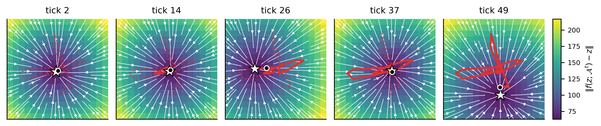

# Riding the Fixed-Point Curve: Image Classification in the Continuous Thought Machine

[](https://arxiv.org/abs/2610.19220)

**Thomas Hannagan** (Stellantis) · NeurIPS 2026 Workshop on Symmetry and Geometry in Neural Representations (NeurReps), extended abstract track (non-archival)

Paper: **[arxiv.org/abs/2610.19220](https://arxiv.org/abs/2610.19220)** · Poster: [`poster/poster_neurreps2026.pdf`](poster/poster_neurreps2026.pdf)



The [Continuous Thought Machine](https://github.com/SakanaAI/continuous-thought-machines) (CTM) is a recurrent network that attends to its input and makes predictions from the synchronization between its neurons. This repository reproduces every figure, table and number of our analysis of how the official ImageNet CTM classifies images:

- **Thinking steps are attracting but strongly non-normal maps.** With the memory frozen, one tick is an ordinary map whose fixed point is locally unique and attracting (ρ(J) < 1), while its largest singular value exceeds one: balanced amplification (Murphy & Miller, 2009). Attraction is present at initialization; training sharpens the non-normality.
- **The thought is a curve of moving fixed points, followed one tick behind.** Most of that curve's motion is shared across images, and it accounts for the traveling waves reported by the CTM authors.
- **Attention follows a largely generic schedule.** Shuffling queries across images at every tick costs only 7% of accuracy, and an image-independent increment predicts the next query (R² = 0.98, held out). The schedule shifts each image's curve but does not drive its motion.

## Contents

| Path | What it is |
|---|---|
| [`notebooks/ctm_reproduce_imagenet_1000cls.ipynb`](notebooks/ctm_reproduce_imagenet_1000cls.ipynb) [](https://colab.research.google.com/github/THANNAGA/ctm-fixed-point-curve/blob/main/notebooks/ctm_reproduce_imagenet_1000cls.ipynb) | Everything on ImageNet: all figures, Tables 1, 3 and 4, the ImageNet row of Table 2, and every number in the text. Official checkpoint, **no training**. |
| [`notebooks/ctm_reproduce_mnist_cifar.ipynb`](notebooks/ctm_reproduce_mnist_cifar.ipynb) [](https://colab.research.google.com/github/THANNAGA/ctm-fixed-point-curve/blob/main/notebooks/ctm_reproduce_mnist_cifar.ipynb) | §8 (smaller models): trains D = 128 CTMs on MNIST and CIFAR-10 (three seeds each) and reproduces the MNIST and CIFAR rows of Table 2. |
| [`poster/`](poster) | The NeurReps 2026 poster. |

Each notebook opens with a table mapping every paper figure and table to the cell that produces it. Cells are tagged by paper section (`[3.1]`, `[B.2]`, …), and figures are saved under their paper numbers (`fig2_…`, `fig3_…`).

## Running the notebooks

Both notebooks are written for **Google Colab** with Google Drive mounted.

| Notebook | |
|---|---|
| ImageNet | [](https://colab.research.google.com/github/THANNAGA/ctm-fixed-point-curve/blob/main/notebooks/ctm_reproduce_imagenet_1000cls.ipynb) |
| MNIST / CIFAR | [](https://colab.research.google.com/github/THANNAGA/ctm-fixed-point-curve/blob/main/notebooks/ctm_reproduce_mnist_cifar.ipynb) |

**ImageNet notebook.**
- **GPU:** an A100 (40 GB or more) is recommended.
- **Model:** the official [CTM code](https://github.com/SakanaAI/continuous-thought-machines) is cloned at run time, and the official ImageNet checkpoint is downloaded from the authors' release and kept on your Drive.
- **Data:** the ImageNet validation set (1000 classes × 50 images) is downloaded once from Kaggle ([`titericz/imagenet1k-val`](https://www.kaggle.com/datasets/titericz/imagenet1k-val)) and kept on your Drive as a single archive. It needs a Kaggle API token, stored as a Colab secret named `KAGGLE_API_TOKEN`; never paste a token into the notebook.
- **Storage:** everything is written to one Drive folder (`DRIVE_DIR` in the configuration cell, by default `MyDrive/ctm_project_imagenet1000`), with sub-folders for the checkpoint, data, cache and figures.
- **Two presets, set by `PRESET` in the configuration cell:**
  - `PRESET = 'PAPER'` (default) reproduces the paper's sample sizes, about 4–5 hours on an A100 the first time.
  - `PRESET = 'FAST'` runs the whole notebook end to end on about a tenth of the samples, in well under an hour.
- **Caching:** every expensive cell caches its result on Drive, so a later "Run all" takes about 30 minutes and an interrupted session resumes where it stopped. Cache keys include the sample size, so the two presets never mix.

**MNIST / CIFAR notebook.**
- **Runtime:** training all models from scratch takes about two hours on a Colab GPU, mostly CIFAR.
- **Reuse:** checkpoints are saved to Drive and reloaded on later runs.

## Citation

```bibtex
@misc{hannagan2026riding,
  title         = {Riding the Fixed-Point Curve: Image Classification in the Continuous Thought Machine},
  author        = {Hannagan, Thomas},
  year          = {2026},
  eprint        = {2610.19220},
  archivePrefix = {arXiv},
  primaryClass  = {cs.LG},
  note          = {NeurIPS 2026 Workshop on Symmetry and Geometry in Neural Representations (NeurReps)}
}
```

## Acknowledgments

This work analyzes the Continuous Thought Machine of Darlow, Regan, Risi, Seely and Jones (2025), and uses their [code](https://github.com/SakanaAI/continuous-thought-machines) and released ImageNet checkpoint, which remain under their own license.

## License

The notebooks in this repository are released under the MIT License, © 2026 Stellantis (see [`LICENSE`](LICENSE)). The paper is distributed by arXiv under its own license.
